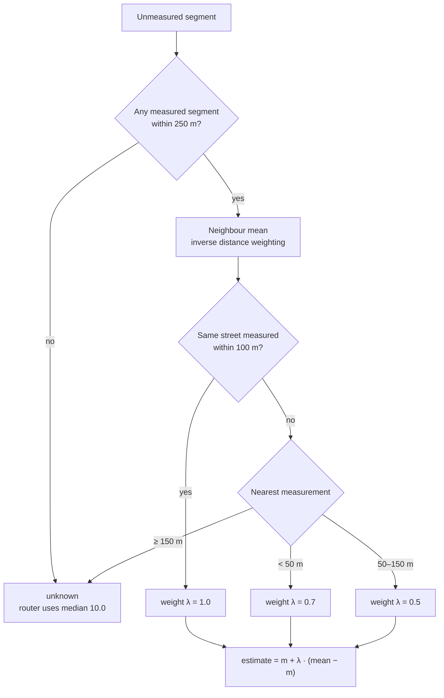

# Filling in unmeasured streets

The bike router needs a **roughness** value (0–100, higher = bumpier) on every street, but the ATRAI bike sensors only measured part of Heilbronn. This folder estimates the rest.

| Dataset | Measured segments | Share of all 34,243 segments |
| :--- | :---: | :---: |
| Roughness (`bumpy_roads_heilbronn`) | 9,599 | 28.0% |
| Traffic flow (`traffic_flow_heilbronn`) | 7,153 | 20.9% |

## In one minute

* **Roughness is estimated from nearby measured streets, not from a machine learning model.** We tested a Random Forest with 36 features and it did slightly *worse* than simply averaging the neighbours.
* The closer the measurements, the more we trust them. **When nothing measured is within 150 m, the street is marked `unknown`** and the router uses the city median (10.0).
* Of the 24,644 unmeasured segments, **47.7% get an estimate, 52.3% stay unknown**. That is on purpose: beyond ~150 m the neighbours predict no better than the median.
* Traffic flow still uses a Random Forest and is **not used in route costs yet**.

---

## How a roughness estimate is made



### Step 1 — Neighbour mean (inverse distance weighting)

For an unmeasured segment, take the measured segments around it. Measured segment *i* has roughness **vᵢ** and is **dᵢ** metres away.

```
              n
              ∑  wᵢ · vᵢ
             i=1                                   1
mean  =  ─────────────────        with      wᵢ = ─────────
              n                                  dᵢ + 25
              ∑  wᵢ
             i=1
```

Closer segments get a larger weight. Dividing by the sum of the weights makes them add up to 1, so the result always lies between the smallest and the largest neighbour value.

| Symbol / setting | Meaning | In the code |
| :--- | :--- | :--- |
| segment position | average of all coordinates of the segment's line | `line_geometry` |
| dᵢ | great-circle distance in metres between two segment positions | `BallTree(metric="haversine")` |
| which neighbours | the 25 nearest measured segments, keeping those within 250 m | `K_NEIGHBOURS = 25`, `RADIUS_M = 250` |
| + 25 | distance offset, see below | `IDW_OFFSET_M = 25` |

The great-circle distance (φ = latitude, λ = longitude in radians, R = 6,371,000 m):

```
d = 2R · arcsin( √( sin²(Δφ/2) + cos φ₁ · cos φ₂ · sin²(Δλ/2) ) )
```

**Why "+ 25"?** The textbook version is wᵢ = 1 / dᵢ. When a neighbour is almost on top of the segment (dᵢ → 0) its weight goes to infinity and every other neighbour is ignored. Adding 25 m caps the weight:

| Distance | Weight 1/(d + 25) | Relative to 0 m |
| :---: | :---: | :---: |
| 0 m | 0.0400 | 1.00 |
| 25 m | 0.0200 | 0.50 |
| 75 m | 0.0100 | 0.25 |
| 225 m | 0.0040 | 0.10 |

So the nearest and the furthest neighbour differ by at most about 10×.

### Step 2 — Pull towards the median

The neighbour mean is then moved part of the way towards the city median **m = 10.0**:

```
estimate = m + λ · (mean − m)
```

λ = 1 keeps the neighbour mean, λ = 0 is just the median.

| Situation | λ | Label |
| :--- | :---: | :--- |
| Same street measured within 100 m | 1.0 | `estimated` |
| Only other streets; nearest measurement < 50 m | 0.7 | `estimated` |
| Only other streets; nearest measurement 50–150 m | 0.5 | `estimated` |
| Nothing measured within 150 m | — | `unknown` |

The settings are `SAME_STREET_RADIUS_M = 100` and `SHRINK_BY_NEAREST_M = ((50, 0.7), (150, 0.5))` in `train_imputer.py`; the logic is in `neighbour_estimates`.

### Worked example

A segment has three measured neighbours, all on other streets:

| Neighbour | Distance | Roughness | Weight 1/(d + 25) | Share of weight |
| :---: | :---: | :---: | :---: | :---: |
| A | 10 m | 30 | 1/35 = 0.02857 | 63.8% |
| B | 60 m | 10 | 1/85 = 0.01176 | 26.3% |
| C | 200 m | 5 | 1/225 = 0.00444 | 9.9% |

```
mean     = (0.02857 × 30 + 0.01176 × 10 + 0.00444 × 5) / (0.02857 + 0.01176 + 0.00444)
         ≈ 22.26

nearest is 10 m (< 50 m), so λ = 0.7
estimate = 10 + 0.7 × (22.26 − 10) ≈ 18.59
```

If A were on the same street, λ would be 1.0 and the estimate would be 22.26.

### Step 3 — From segments to the router

The router works on OpenStreetMap ways (one way = several segments). For every edge it uses, in this order:

1. the measured mean of its way, if any segment of that way was measured → `measured`
2. otherwise the mean of the estimates on that way → `estimated`
3. otherwise the median 10.0 (`DEFAULT_ROUGHNESS` in `routing/costs.py`) → `unknown`

The route cost of an edge is `length × (1 + penalty × roughness / 100)` (`edge_cost` in `routing/costs.py`).

---

## Why this method

### Road type does not predict roughness here

Ranking quality on held-out streets (Spearman rank correlation: 1 = perfect order, 0 = random):

| Estimate | Spearman |
| :--- | :---: |
| Neighbour mean (inverse distance weighting), no model | **0.379** |
| Random Forest on 36 features (neighbours, OpenStreetMap highway and surface tags, geometry) | 0.361 |
| Median roughness of the segment's highway + surface type | 0.061 |

Measured medians are 10.0 for asphalt, 11.2 for paving stones, 13.9 for sett and 16.0 for gravel, and 90% of the measured segments are asphalt. Roughness is mostly a property of the **neighbourhood** (same paving era, same budget), not of the road type. Following road connections instead of straight-line distance did not help reliably either (+0.006 ± 0.004 over five different splits).

### Far-away neighbours are worse than guessing

Grouped by how far the nearest measurement is:

| Nearest measurement | Spearman | Average error of neighbour mean | Average error of median |
| :--- | :---: | :---: | :---: |
| 0–100 m | 0.378 | **5.83** | 6.17 |
| 100–250 m | 0.223 | 6.55 | **6.11** |
| 250–375 m | 0.185 | 6.63 | **5.97** |
| 375–500 m | 0.120 | 7.01 | **6.33** |

Beyond about 100 m the raw neighbour mean has a larger error than the median. That is why λ shrinks with distance, and why a bigger search radius would only *look* like better coverage.

### How λ was chosen

For each distance band we picked the λ with the lowest average error on held-out streets. Tuned on half of the streets, it lowered the error on the other half from 5.84 (λ = 1) to 5.63. The best λ was **never above 1**, so we also do not stretch the estimates to the full 0–100 range (quantile mapping): that would make every band less accurate.

---

## Validation

Numbers from `ml/metrics.json`. "Held out" = those measurements were hidden and then predicted.

| Held out | Average error, always guess median | Average error, this method | R² | Spearman |
| :--- | :---: | :---: | :---: | :---: |
| Whole streets | 6.131 | **5.636** | 0.152 | 0.376 |
| Whole 1 km × 1 km blocks | 6.152 | 6.111 | −0.082 | 0.033 |
| Random segments (other parts of the street measured) | 6.131 | **4.972** | 0.366 | 0.538 |

For comparison, the previous Random Forest scored 5.909 on whole streets and 6.728 on whole blocks (worse than the median). λ was tuned on the same measurements, so these numbers are slightly optimistic.

## Effect on routes

40 random trips over 1.5 km. Share of route length on each kind of street, compared with the plain shortest route (1.00× = no preference):

| Penalty | Measured | Estimated | Unknown | Extra distance |
| :---: | :---: | :---: | :---: | :---: |
| 10 | 1.00× | 0.93× | 1.02× | +1.6% |
| 30 | 1.01× | 0.94× | 1.00× | +4.0% |

The router neither prefers nor avoids unknown streets. Estimated streets are slightly avoided because their typical value (median 11.4) is a bit above the 10.0 used for unknown streets.

## Known limits

* **Half of the unmeasured network stays unknown.** Nothing measured is close enough; no method can recover that.
* **A whole unmeasured neighbourhood cannot be estimated** (Spearman 0.03 on held-out 1 km blocks): all the signal comes from nearby streets.
* **Possible hidden bias:** if cyclists avoid rough streets, unmeasured streets are rougher than the measured ones suggest. This data cannot test that.

---

## Traffic flow (Random Forest, not used for routing yet)

Features: OpenStreetMap highway and surface tags (`data/osm_tags_cache.json`, fetched by `fetch_osm_highways.py`; a missing surface is filled in from the highway type), segment geometry and neighbour values.

| Held out | Average error, median | Average error, Random Forest | R² | Spearman |
| :--- | :---: | :---: | :---: | :---: |
| Whole streets | 0.127 | **0.105** | 0.315 | 0.531 |
| Whole 1 km blocks | 0.128 | 0.130 | −0.067 | 0.215 |

**Check before adding it to route costs:** measured values are highest on `track` (0.45) and lowest on `pedestrian` (0.19). That looks more like *cyclist* traffic than car traffic; if so, high traffic flow is good, not something to avoid.

---

## Files

| File | What it is |
| :--- | :--- |
| `train_imputer.py` | Builds both estimates, runs the validation, writes the outputs below |
| `fetch_osm_highways.py` | Downloads highway / surface tags for all 11,011 OpenStreetMap ways (used by traffic flow) |
| `export_enriched_geojson.py` | Writes one GeoJSON with every segment's values and sources, for Kepler.gl / QGIS |
| `../data/ml_predicted_roughness.json` | Roughness estimates for 3,466 unmeasured OpenStreetMap ways |
| `../data/ml_predicted_traffic_flow.json` | Traffic flow estimates for 6,784 unmeasured ways |
| `../data/road_network_enriched_heilbronn.geojson` | All 34,243 segments with `roughness`, `traffic_flow`, `highway`, `surface` and their source (`measured` / `estimated` / `unknown`) |
| `metrics.json` | Validation numbers and coverage |
| `roughness_performance.png`, `traffic_flow_performance.png` | Measured vs estimated on held-out streets |

## Rerun

```bash
.venv/bin/python ml/train_imputer.py
.venv/bin/python ml/export_enriched_geojson.py
.venv/bin/python -m pytest tests/
```

## Glossary

| Term | Meaning |
| :--- | :--- |
| Segment | One piece of road between two points in `road_network_heilbronn.geojson` (34,243 in total) |
| OpenStreetMap way | A named road object in OpenStreetMap; usually several segments |
| Inverse distance weighting | Average of nearby values where closer values count more (Step 1) |
| Median | Middle value of all measured roughness values (10.0) |
| Average error | Mean absolute error: average of \|measured − estimated\| |
| R² | Share of the variation explained; 0 = no better than a constant, negative = worse |
| Spearman rank correlation | How well the estimates put streets in the right order; what matters most for routing |
| Held-out streets / blocks | Cross-validation where whole streets or whole 1 km blocks are hidden at once, so a street is never predicted from its own measurements |
